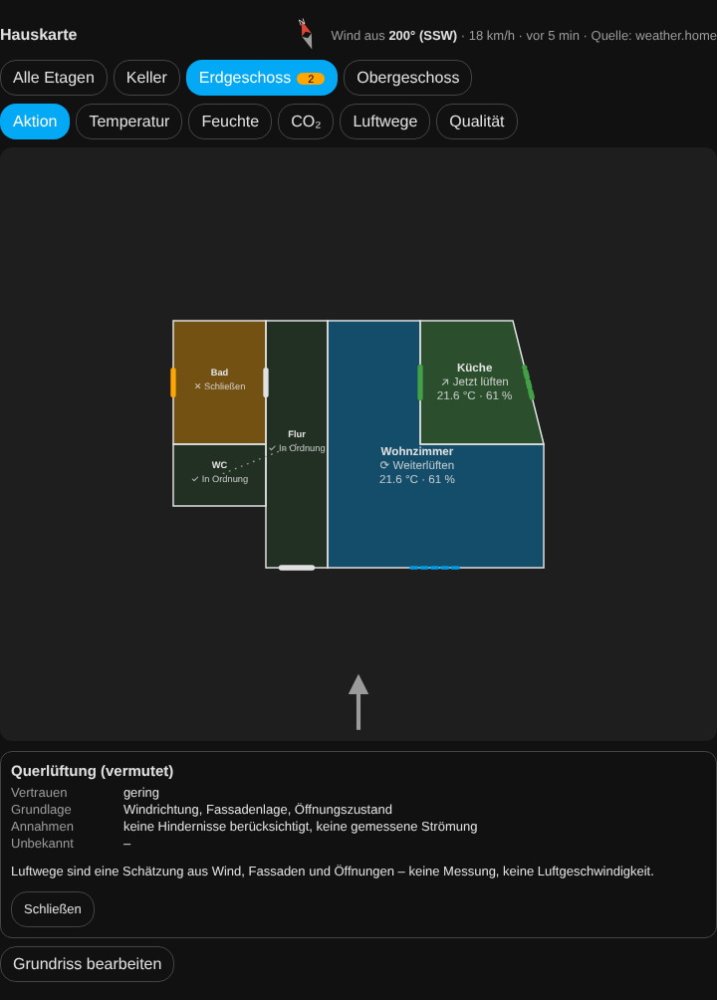
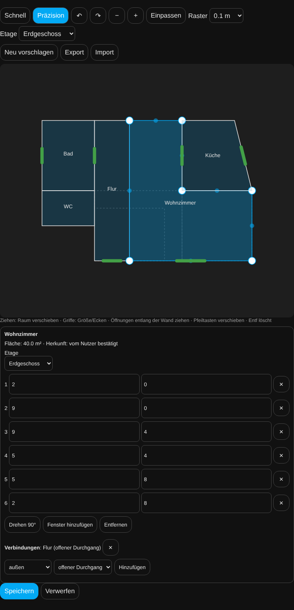
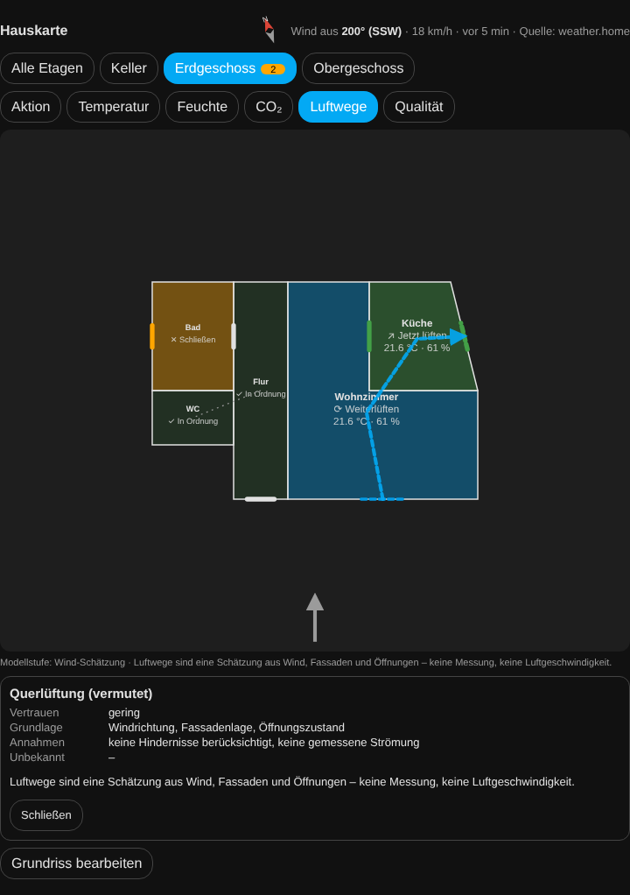
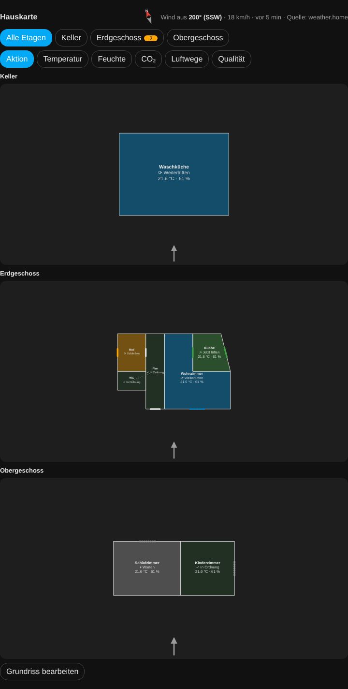

# Hauskarte (optional)

Die Hauskarte zeigt deine FreshAirIQ-Räume auf einem frei formbaren Grundriss: welcher Raum gerade
Handlung braucht, warum, welche Fenster und Türen wie offen sind, woher der Wind kommt und welche
Luftwege daraus **vermutlich** entstehen. Sie ist eine zusätzliche Karte – das bisherige Dashboard,
alle Entities, Empfehlungen, Meldungen und Automationen bleiben unverändert.



## Einrichten in vier Schritten

1. **Karte hinzufügen:** Dashboard bearbeiten → Karte hinzufügen → „FreshAirIQ Hauskarte“
   (YAML: `type: custom:freshairiq-house-card`). Oder in einer vorhandenen FreshAirIQ-Karte unter
   „Darstellung“ **Hauskarte (Grundriss)** wählen – die Karte zeigt dann den Grundriss statt des Dashboards.
2. **Vorschlag ansehen:** Beim ersten Öffnen erstellt FreshAirIQ einen Grundrissvorschlag aus deinen
   Räumen, Etagen, Raummaßen bzw. Volumen, gemeinsamen Türkontakten, offenen Verbindungen und
   Fensterausrichtungen. Er ist als „Automatischer Vorschlag – noch nicht gespeichert“ markiert.
3. **Anpassen:** „Grundriss bearbeiten“ (nur für Administratoren). Räume verschieben, Größe ändern,
   drehen, Ecken setzen, Fenster an die richtige Wand ziehen.
4. **Nordrichtung prüfen und speichern:** Im Editor ohne Auswahl „Norden (Grad, Richtung ‚oben‘)“ eintragen
   und „Nordrichtung geprüft“ anhaken. Erst dann ordnet die Karte den Wind einzelnen Wänden zu.

Du kannst jederzeit überspringen: Auch der ungespeicherte Vorschlag zeigt sofort Temperatur, Feuchte,
Empfehlungen und Öffnungszustände.

## Was der Vorschlag weiß – und was nicht

Home Assistant kennt Raumnamen und Etagen, aber **keine** Wandkoordinaten oder Fensterflächen. Jeder Raum
trägt deshalb seine Herkunft:

| Herkunft | Bedeutung |
|---|---|
| aus Konfiguration berechnet | Länge × Breite aus der Raumeinrichtung |
| geschätzt | Fläche aus Volumen ÷ Höhe (2,5 m, wenn unbekannt), quadratisch angenommen |
| schematisch | keine Größe bekannt – Schemaplan ohne Maßstab |
| vom Nutzer bestätigt | von dir gezeichnet oder verändert |

Der Vorschlag verändert **nie** Raumvolumen oder Raumkonfiguration und wird nach einem Neustart,
Wetterwechsel oder Update nicht neu platziert. „Neu vorschlagen“ zeigt vorher, wie viele Räume sich
ändern würden; „Fehlende Räume ergänzen“ fügt nur neue Räume hinzu, ohne vorhandene zu verschieben.

## Editor



- **Schnell:** Raum ziehen = verschieben, Griff oben rechts = Größe, „Drehen 90°“, Vorlagen
  Rechteck/L/U für neue Räume, Öffnungen entlang der Wand ziehen.
- **Präzision:** Ecken ziehen, Punkt in der Wandmitte = Ecke einfügen, Ecke auswählen + Entf/✕ = löschen,
  Koordinaten numerisch eingeben, Raster 0,05–0,5 m.
- Rückgängig/Wiederholen (auch Strg+Z/Strg+Y), Zoom, Einpassen, Zwei-Finger-Zoom, Pfeiltasten verschieben.
- Öffnungen: Art (Fenster, Tür, Dachfenster, Durchgang, Lüftungsöffnung), Mechanik (Dreh-Kipp, Drehflügel,
  nur Kipp, Schiebe …), Breite, zugeordnete Kontakte.
- **Öffnungen setzen** (Leiste über der Zeichnung, auch ohne Grundriss-Vorlage): „Fenster antippen“, „Innentür
  antippen“, „Durchgang antippen“ und dann auf eine Wand tippen. Innentür und Durchgang gehören auf eine Wand
  zwischen zwei Räumen (sonst Hinweis „keine Innenwand“); die Luftwege lesen sie als Verbindung beider Räume.
  Eine Tür zählt nach ihrem Kontakt als offen, ein Durchgang ist immer offen.
  Die ganze Breite muss auf einer gemeinsamen Wandstrecke liegen (Wandabstand bis 5 cm; eine gemeinsame Ecke
  reicht nicht); der Editor setzt die Öffnung mittig auf diese Strecke und kürzt die Breite bei Bedarf. Passt sie
  später nicht mehr, zeigt er „zählt als Außenöffnung“.
- **Breite:** bei einer ausgewählten Öffnung die beiden runden Griffe an ihren Enden ziehen (bleibt mittig, in
  ihrer Wand, mindestens 0,3 m, am Raster) oder „−“/„+“ (je 5 cm) bzw. das Feld „Breite (m)“ nutzen.
- Verbindungen je Raum (offener Durchgang, Tür, Treppe, Schacht, Kanal) – zu einem anderen Raum oder nach außen.
- Fehler stehen direkt am Raum („Wände kreuzen sich“, „überlappt einen anderen Raum“ …); ein ungültiger
  Grundriss wird nicht gespeichert.
- Hat jemand anderes inzwischen gespeichert, wird **nicht überschrieben**: Entwurf exportieren, neu laden.
- Export/Import als JSON.

## Grundriss-Vorlage (Bild hochladen und Räume antippen)

Statt alles von Hand zu zeichnen, kannst du je Etage ein Bild deines Grundrisses als Vorlage hinterlegen
(Architektenplan, Exposé-Grundriss, Scan oder Foto) und die Räume darauf antippen:

1. **Bild hochladen** (Editor → „Grundriss-Vorlage“). PNG, JPEG oder WebP. **PDF wird nicht unterstützt** –
   speichere die Seite vorher als Bild (Bildschirmfoto/Export) oder fotografiere den Plan gerade von oben ab.
   Das Bild wird im Browser verkleinert (längste Seite 2000 Pixel) und bleibt lokal in Home Assistant.
2. **Maßstab:** zwei Punkte einer Strecke mit bekannter Länge antippen (z. B. eine bemaßte Wand) und die Länge
   in Metern eingeben. Ohne Maßstab werden keine Räume übernommen.
3. **Norden** (optional): zwei Punkte entlang des Nordpfeils im Plan antippen – erst das Ende, dann die Spitze.
   Die Nordrichtung des Grundrisses wird damit gesetzt und als geprüft markiert.
4. **Raum antippen:** in einen Raum der Vorlage tippen. Die von Wänden umschlossene Fläche wird erkannt, als Umriss
   gezeigt und mit ihrer Fläche angezeigt. Darunter stehen die passendsten FreshAirIQ-Räume (Vergleich mit Länge ×
   Breite bzw. Volumen ÷ Raumhöhe aus der Raumeinrichtung); ein Tipp ordnet zu. Jeder andere Raum ist über die
   Auswahl erreichbar. Ein schon gezeichneter Raum wird ersetzt; seine Fenster wandern an die Wand mit derselben
   Himmelsrichtung und behalten ihre Kontakte.
5. **Fenster antippen:** auf eine Wand tippen – dort entsteht ein Fenster, das du wie gewohnt einstellst.

Wenn die Erkennung nicht passt:
- „**Das ist eine Wand**“ – etwas weiter in den Raum tippen.
- „**Der Bereich ist nicht geschlossen**“ oder der Umriss läuft in den Nachbarraum: eine offene Tür oder ein
  Durchgang verbindet die Räume. Den Regler „**Lücken schließen**“ erhöhen oder mit „**Trennlinie**“ eine Linie
  quer über den Durchgang ziehen.
- Möbel, Beschriftungen und Maßketten im Raum stören in der Regel nicht; Fotos mit starkem Schatten,
  schräger Aufnahme oder sehr dünnen Wandlinien können schlechter erkannt werden – dann hilft eine Trennlinie
  oder das Nachzeichnen von Hand.

Die Erkennung läuft vollständig im Browser, ohne Internet und ohne fremde Dienste. Eine vollautomatische
Erkennung aller Räume (inklusive Fenster und Türen aus Symbolen) gibt es bewusst nicht – sie wäre auf
unterschiedlichen Plänen zu unzuverlässig.

## Ebenen

Aktion · Temperatur · Feuchte · CO₂ · Luftwege · Qualität. Die Aktion jedes Raums stammt aus genau
denselben Daten wie Dashboard, Push und Automations-Events – die Karte entscheidet nichts selbst.
Farbe ist nie die einzige Information: jeder Raum zeigt Wort und Symbol. Ein Schimmelrisiko „hoch“
verhindert „grün“, „sehr hoch“ färbt den Raum rot – das Aktionswort bleibt dabei die FreshAirIQ-Empfehlung.

## Fenster und Türen ehrlich dargestellt

| Darstellung | Bedeutung |
|---|---|
| geschlossen | Kontakt meldet geschlossen |
| gekippt | nur mit nachgewiesenem 3-Zustands-Kontakt |
| ganz offen | nur mit nachgewiesenem 3-Zustands-Kontakt |
| offen – Öffnungsart unbekannt | normaler Fensterkontakt (auf/zu) |
| Kontakt offen – Bestätigung läuft | die eingestellte Öffnungsverzögerung dieses Kontakts läuft noch |
| Zustand unbekannt / ohne Sensor | keine verlässliche Angabe |

## Wind und Luftwege



Wind kommt aus der Wetterentität (Grad oder Himmelsrichtung, Einheit km/h, m/s, mph, Knoten). Der Pfeil
zeigt, **woher** der Wind kommt. Fehlt die Richtung, ist sie veraltet oder windstill, wird kein Pfeil
gezeichnet.

Der Wind wird als weiche, halbtransparente Wellenbänder gezeichnet, die an Wänden umgelenkt werden und durch
bestätigt offene Fenster einströmen. Die Wellen laufen ohne Neustart weiter – auch wenn sich Daten ändern
oder die Karte neu gezeichnet wird; stärkerer Wind lässt sie schneller laufen. Bei „Bewegung reduzieren“ des
Geräts oder ausgeschalteter Animation stehen sie still.

Luftwege sind eine **Schätzung**, keine Messung und keine Luftgeschwindigkeit:

| Modellstufe | Grundlage |
|---|---|
| nur Verbindungen | bekannte Durchgänge und Kontaktzustände, keine Richtung |
| Wind-Schätzung | Wind + Fassadenlage (nur mit geprüfter Nordrichtung oder eingestellter Fensterausrichtung) |
| Wind + Öffnungsart | zusätzlich nachgewiesene Kipp/Offen-Stellung jeder aktiven Außenöffnung |

Ein Tipp auf einen Luftweg erklärt Grundlage, Annahmen und Unbekanntes. Einseitiges Lüften erscheint als
„Austausch am Fenster“, ohne passende Gegenöffnung entsteht kein erfundener Querweg, eine geschlossene
Zwischentür stoppt den Weg, und über Treppen oder Decken wird nichts behauptet. Ein Ablüfter zeigt seine
vermutete Ersatzluft; ein Referenzsensor im Nachbarraum ist **kein** Nachweis eines Luftwegs.

## Etagen

Etagenreiter mit Zähler der Räume mit Handlungsbedarf, „Alle Etagen“ als Übersicht.



Auto-Fokus (Karteneinstellung `auto_focus`):

- `off` – nie automatisch wechseln
- `hint` (Standard) – Hinweis „Handlung auf anderer Etage“ mit Sprung-Schaltfläche
- `auto` – bei einer **neuen** Handlung auf einer anderen Etage dorthin wechseln. Eine manuelle Wahl hält
  `manual_lock_min` Minuten (Standard 10, sichtbar „Auto-Fokus pausiert bis …“); höchstens ein
  automatischer Wechsel pro Minute.

## Karteneinstellungen

```yaml
type: custom:freshairiq-house-card
title: Hauskarte          # optional
auto_focus: hint          # off | hint | auto
layer: action             # action | temperature | humidity | co2 | airflow | quality
manual_lock_min: 10
animation: true           # Luftweg-Animation (bei „Bewegung reduzieren“ immer aus)
entry_id: ...             # nur bei mehreren FreshAirIQ-Einträgen
```

## Was die Karte bewusst (noch) nicht kann

- **Keine Strömungsberechnung:** Windumlenkung um Ecken, Wirbel an Fassaden oder Hindernisse werden nicht berechnet.
  Die Anströmung jeder Wand ist eine Einordnung (zugewandt/seitlich/abgewandt), Luftwege sind Linien zwischen
  Öffnungen und Raummitten – eine Topologie-Annahme.
- **Kipp vs. ganz offen** unterscheidet Symbol und Einordnung (klein/groß), nicht Öffnungswinkel, Flügelrichtung,
  Höhe, wirksame Fläche oder Volumenstrom.
- **Auto-Vorschlag** erzeugt nur rechteckige Räume in zwei einfachen Anordnungen; echte L-/U-Formen, die
  Gebäudeaußenkontur und Höhenversätze kennt FreshAirIQ nicht – diese zeichnest du im Editor.
- **Etagen-Auto-Fokus** ist standardmäßig auf „Nur Hinweis“; automatisches Wechseln schaltest du mit `auto_focus: auto` ein.
- Keine PDF-Vorlage (nur Bilder), keine vollautomatische Raumerkennung, keine Kalibrierung abgeleiteter Luftmengen.

## Datenschutz und Grenzen

- Der Grundriss wird lokal in Home Assistant gespeichert (`.storage/freshairiq.house_layout.<entry>`) und
  **nicht** an den Diagnose-Hub übertragen; er ist nicht Teil des Diagnose-Exports.
- Eine Grundriss-Vorlage (Bild) liegt getrennt davon in `.storage/freshairiq.house_underlay.<entry>`, ebenfalls
  nur lokal und nicht in Diagnose oder Upload. Sie wird nur im Editor angezeigt. „Vorlage löschen“ entfernt sie.
- Wird die FreshAirIQ-Integration in Home Assistant gelöscht, werden Grundriss und Vorlage mitgelöscht.
- Keine Cloud, keine Kartendienste; ohne Internet und ohne Winddaten bleibt die Karte vollständig nutzbar.
- Speichern nur für Administratoren. Home-Assistant-Bereiche, Etagen und Geräte werden nur gelesen.
- Keine Strömungssimulation (CFD), keine gemessenen Luftmengen; Hindernisse wie Nachbarhäuser werden
  nicht berücksichtigt.
- Beispiel-Grundriss ohne echte Daten: [examples/house_map_demo.json](examples/house_map_demo.json).
