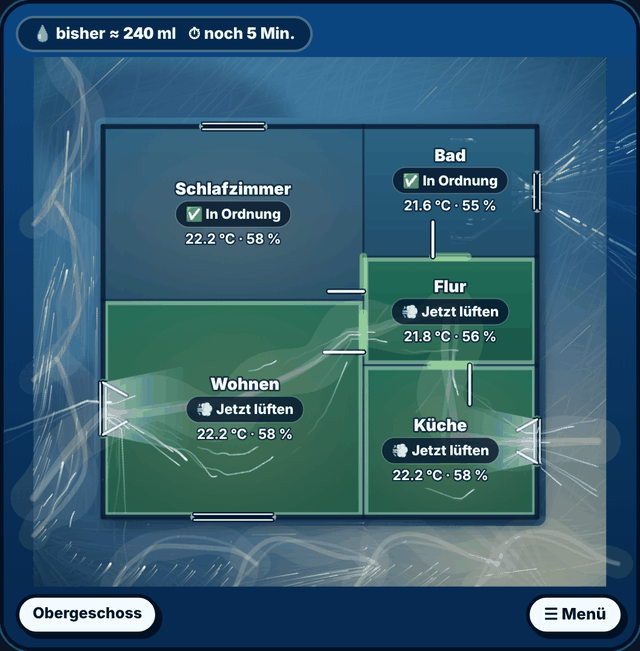
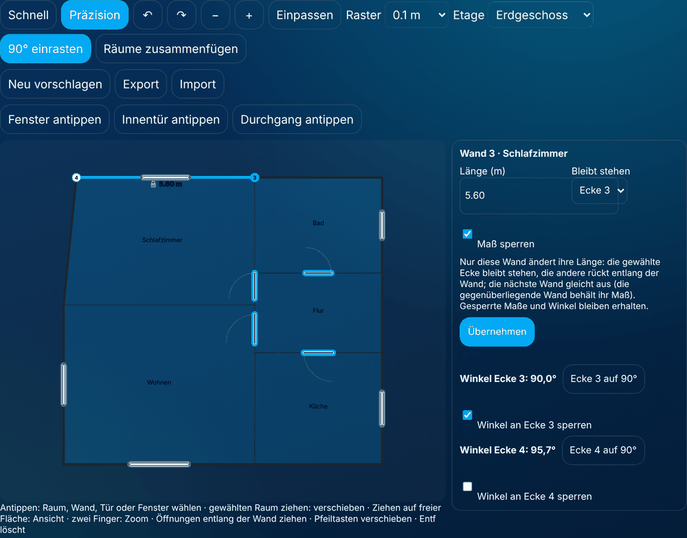
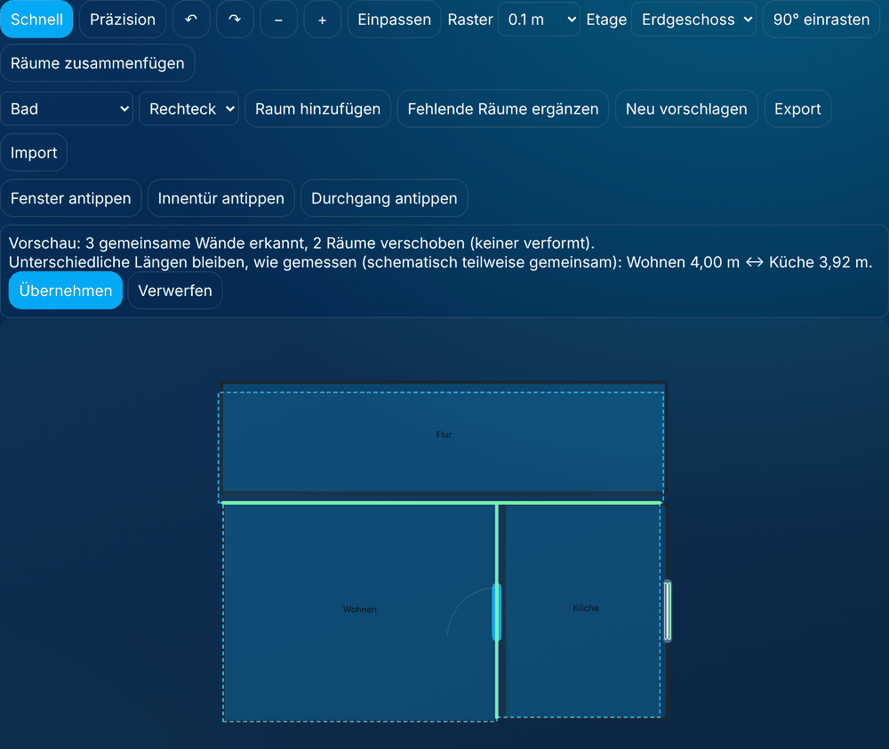
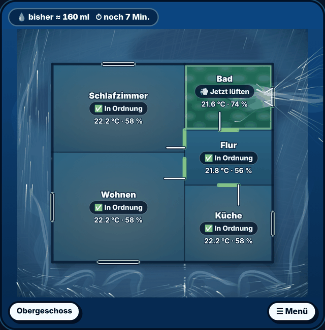
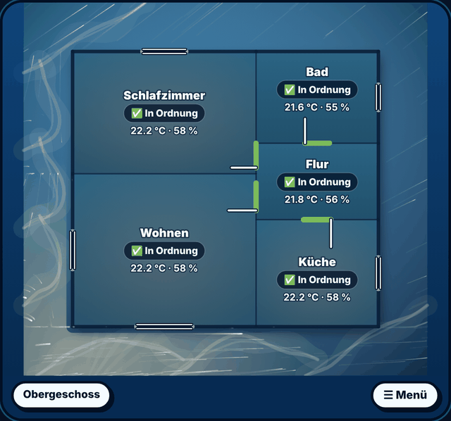

# Hauskarte (optional)

Die Hauskarte zeigt deine FreshAirIQ-Räume auf einem frei formbaren Grundriss: welcher Raum gerade
Handlung braucht, warum, welche Fenster und Türen wie offen sind, woher der Wind kommt und welche
Luftwege daraus **vermutlich** entstehen. Sie ist eine zusätzliche Karte – das bisherige Dashboard,
alle Entities, Empfehlungen, Meldungen und Automationen bleiben unverändert.



## Einrichten in vier Schritten

1. **Karte hinzufügen:** Dashboard bearbeiten → Karte hinzufügen → „FreshAirIQ Hauskarte“
   (YAML: `type: custom:freshairiq-house-card`). Oder in einer vorhandenen FreshAirIQ-Karte unter
   „Darstellung“ **Hauskarte (Grundriss)** wählen – die Karte zeigt dann den Grundriss statt des Dashboards.
2. **Vorschlag ansehen:** Beim ersten Öffnen erstellt FreshAirIQ einen Grundrissvorschlag aus deinen
   Räumen, Etagen, Raummaßen bzw. Volumen, gemeinsamen Türkontakten, offenen Verbindungen und
   Fensterausrichtungen. Er ist als „Automatischer Vorschlag – noch nicht gespeichert“ markiert.
3. **Anpassen:** „Grundriss bearbeiten“ (nur für Administratoren). Räume verschieben, Größe ändern,
   drehen, Ecken setzen, Fenster an die richtige Wand ziehen.
4. **Nordrichtung prüfen und speichern:** Im Editor ohne Auswahl „In welche Himmelsrichtung zeigt dein Grundriss
   nach oben?“ beantworten – den Pfeil „N“ der Kompassrose ziehen oder den Winkel eingeben (0° = oben Norden, 90° = oben
   Osten, 180° = oben Süden, 270° = oben Westen; 345° heißt „oben zeigt ungefähr nach Nord-Nordwest“). Die Räume werden
   dabei nicht gedreht. „Nordrichtung geprüft“ erst anhaken, wenn die Richtung anhand eines Lageplans, einer Karte oder
   eines Kompasses kontrolliert ist – erst dann ordnet die Karte Sonne und Wind einzelnen Wänden zu.

Du kannst jederzeit überspringen: Auch der ungespeicherte Vorschlag zeigt sofort Temperatur, Feuchte,
Empfehlungen und Öffnungszustände.

## Was der Vorschlag weiß – und was nicht

Home Assistant kennt Raumnamen und Etagen, aber **keine** Wandkoordinaten oder Fensterflächen. Jeder Raum
trägt deshalb seine Herkunft:

| Herkunft | Bedeutung |
|---|---|
| aus Konfiguration berechnet | Länge × Breite aus der Raumeinrichtung |
| geschätzt | Fläche aus Volumen ÷ Höhe (2,5 m, wenn unbekannt), quadratisch angenommen |
| schematisch | keine Größe bekannt – Schemaplan ohne Maßstab |
| vom Nutzer bestätigt | von dir gezeichnet oder verändert |

Der Vorschlag verändert **nie** Raumvolumen oder Raumkonfiguration und wird nach einem Neustart,
Wetterwechsel oder Update nicht neu platziert. „Neu vorschlagen“ zeigt vorher, wie viele Räume sich
ändern würden; „Fehlende Räume ergänzen“ fügt nur neue Räume hinzu, ohne vorhandene zu verschieben.

## Editor



- **Schnell:** Raum ziehen = verschieben, Griff oben rechts = Größe, „Drehen 90°“ (nach Antippen des Raums in seinen
  Eigenschaften: dreht ihn um seine Mitte gegen den Uhrzeigersinn, Fenster und Türen drehen mit; viermal = wie vorher,
  ↶ macht es rückgängig), Vorlagen
  Rechteck/L/U für neue Räume, Öffnungen entlang der Wand ziehen.
- **Präzision:** Ecken ziehen, Punkt in der Wandmitte = Ecke einfügen, Ecke auswählen + Entf/✕ = löschen,
  Koordinaten numerisch eingeben, Raster 0,05–0,5 m.
- Rückgängig/Wiederholen (auch Strg+Z/Strg+Y), Zoom, Einpassen, Zwei-Finger-Zoom, Pfeiltasten verschieben.
- Öffnungen: Art (Fenster, Tür, Dachfenster, Durchgang, Lüftungsöffnung), Mechanik (Dreh-Kipp, Drehflügel,
  nur Kipp, Schiebe …), Breite, zugeordnete Kontakte.
- **Ansicht (0.26.6.0):** der Grundriss füllt die ganze Karte. Unten rechts auf dem Plan liegt **☰ Menü** mit Ebenen
  (Aktion, Temperatur, Feuchte, CO₂, Luftwege, Qualität), Details (Empfehlung, Wetter, Wind und Kennzahlen), Etagen,
  Gästen, Hinweisen zur Darstellung (Vorschlag, geschätzte Raumgrößen, Nordrichtung, Windströme schematisch, Luftweg-Modell)
  sowie Support & Diagnose und Bearbeiten. Hinweise, die einen Tipp brauchen (andere Etage, Live-Verbindung gestört,
  Auto-Fokus pausiert), liegen oben links auf dem Plan. Außenwände dick, gemeinsame Innenwände dünn; Fenster, Türen und
  Durchgänge mit eigenem Symbol; Verbindungen ohne eingezeichnete Öffnung mit Markierung auf der Wand.
- **Luftstrom (0.26.6.0):** Luft, die durch ein offenes Fenster hereinkommt, bewegt sich nur durch Verbindungen –
  die eingezeichnete Tür bzw. den Durchgang zwischen zwei Räumen, sonst die Mitte der gemeinsamen Wand einer Verbindung –
  und nie durch eine Wand; ohne solche Stelle endet der Strom. Am anderen Ende strömt sie aus dem offenen Fenster wieder
  hinaus (auch aus einem zweiten offenen Fenster desselben Raums, wenn kein Luftweg bekannt ist).
- **Etagen (UI-Hotfix 0.26.6.0):** die anderen Etagen als Buttons in einer Leiste am unteren Kartenrand, unter dem Plan (nie darüber); kein „Alle Etagen“ – für mehrere Etagen die Karte mehrfach einfügen, je Karte mit `floor: ground_floor` / `floor: upper_floor` (Etagen-ID, Ebene oder Name); jede Karte merkt sich ihre Wahl getrennt; eine Etage mit Handlungsbedarf (jetzt lüften, schließen, kritisch) pulsiert dezent, bei „Bewegung reduzieren“ mit festem Punkt.
- **Menü und Support:** das Menü ist ein eigenes Fenster über dem Plan; „Support & Diagnose“ öffnet ein Fenster mit denselben Funktionen wie die FreshAirIQ-Karte (Diagnose mit Pflichtbeschreibung, Export, Feedback).
- **Editor per Touch:** Raum, Wand, Tür oder Fenster antippen; Finger auf Ungewähltem verschiebt die Ansicht, zwei Finger zoomen, nur der gewählte Raum lässt sich ziehen. Wand antippen → Länge in m eingeben, festen Eckpunkt wählen, Übernehmen; „Maß sperren“ hält die Länge. Türen: Anschlag links/rechts und Öffnungsrichtung. Eine Verbindung „Tür“/„offener Durchgang“ lässt sich auf der gemeinsamen Wand als Tür/Durchgang einzeichnen.
- **Bearbeitungsfenster (0.26.6.1):** Der Editor öffnet bildschirmfüllend in einem eigenen Fenster – unabhängig davon,
  wie schmal die Karte im Dashboard ist. Die Zeichnung ist der Mittelpunkt und behält ihre Größe: auf breiten Bildschirmen
  und im Querformat stehen die Eigenschaften fest daneben, auf Tablet hochkant und Smartphone in einem festen Anteil
  darunter (eigener Bildlauf). Oben: Etage, **Schnell | Präzision** (Schnell: ganze Räume verschieben und skalieren;
  Präzision: Ecken, Wandlängen und Winkel), **＋ Raum**, **Fenster**, **Tür**, **Durchgang** und **Mehr** (Raster,
  90° einrasten, Räume zusammenfügen, Neu vorschlagen, Export/Import, Hilfe). Rückgängig/Wiederholen und Zoom/Einpassen
  liegen in den unteren Ecken der Zeichnung, Speichern und Verwerfen unter den Eigenschaften.
  Ein kurzer Hinweis über der Zeichnung sagt, was mit dem gewählten Objekt oder Werkzeug geht („Tippe auf eine Außenwand,
  um ein Fenster zu platzieren.“), sonst den nächsten sinnvollen Schritt; ohne Auswahl zeigen die Eigenschaften die
  Schritte Etage → Räume → Lage/Form → Fenster/Türen → Kontakte → Speichern mit Häkchen. „＋ Raum“: Raum wählen, Form
  als Bild (Rechteck, L, U, eigene Form = Rechteck im Präzisionsmodus), hinzufügen. Eigenschaften je Objekt: Raum (Fläche,
  Fenster hinzufügen, Drehen, Ecken bearbeiten, Etage; Ecken als Zahlen und Verbindungen aufklappbar), Wand (Länge, feste
  Ecke, Sperre, Winkel), Fenster/Tür (Art, Breite, Anschlag, Kontakt; Lage und Mechanik aufklappbar). Am Smartphone gibt
  „Nur Zeichnung“ der Zeichnung die ganze Höhe, die Auswahl bleibt, „Bearbeiten“ holt ihre Eigenschaften zurück.
  „Einpassen“ bleibt aktiv, bis du selbst zoomst oder verschiebst. Farben folgen dem Home-Assistant-Theme; reicht dessen
  Kontrast nicht, nutzt der Editor eine geprüfte helle oder dunkle Darstellung.
- **Wände einzeln, Winkel und Sperren (Editor):** Eine Wandlänge ändert nur diese Wand – die gewählte Ecke bleibt
  stehen, die andere wandert entlang der Wand, die nächste Wand gleicht aus. Die gegenüberliegende Wand behält ihre Länge;
  ein Raum muss kein Rechteck bleiben. Nachbarräume werden nie mitgezogen – würde die Wand in einen Nachbarraum wachsen,
  lehnt der Editor ab und erklärt warum.
  - **Sperren Wand für Wand:** „Maß sperren“ hält eine Länge, „Winkel an Ecke … sperren“ hält einen Winkel. Gesperrte
    Wände und Winkel werden bei späteren Änderungen mitgetragen (der gesperrte Abschnitt verschiebt sich als Ganzes).
    Geht das nicht, ändert sich **nichts**, und der Hinweis nennt die Wand bzw. Ecke und einen Ausweg („Sperre lösen
    oder die andere Ecke stehen lassen“). Freie Geometrie bleibt frei.
  - **90°:** Im Wandfenster stehen die Winkel an beiden Ecken (Innenecken von L- und U-Räumen als 270°) und je ein
    Knopf „Ecke … auf 90°“ – nur diese Ecke wird rechtwinklig, nie alle Räume. „90° einrasten“ in der Werkzeugleiste
    lässt eine gezogene Ecke nahe 90° (±6°) genau rechtwinklig einrasten; das Raster gilt weiter.
- **Räume zusammenfügen (Editor):** Räume einzeln ausmessen, grob aneinanderschieben (bis etwa 35 cm) und
  „Räume zusammenfügen“ tippen. Gegenüberliegende Wände werden erkannt (auch 3,92 m neben 3,98 m), jeder Raum wird nur
  als Ganzes verschoben – nichts wird skaliert oder verbogen, gesperrte Maße haben Vorrang. Erst erscheint eine
  **Vorschau** (gestrichelte Räume, erkannte Innenwände grün, Hinweise zu unterschiedlichen Längen, gesperrten Ecken
  oder Überlappungen); gespeichert wird erst nach „Übernehmen“, Rückgängig/Wiederholen funktionieren. Danach sind die
  gemeinsamen Wände Innenwände (einmal gezeichnet), Türen darauf verbinden beide Räume, Fenster bleiben an der Außenwand.

  

- **Türbögen nur im Editor:** Der Editor zeigt den Schwenkbereich einer Tür als feinen Bogen (zum Einzeichnen von
  Anschlag und Richtung). Die Hauskarte zeigt das Türblatt mit seinem Zustand ohne Bogen; ein unsichtbarer Bogen
  belegt keinen Platz für Beschriftungen.
- **Sonnenstand:** Die Sonne steht auf der Karte dort, wo `sun.sun` sie gerade meldet (Azimut und Höhe, gedreht nach
  der Nordrichtung des Grundrisses) und wandert im Tagesverlauf mit – neu gezeichnet in 2°-Schritten, nicht bei jeder
  Zustandsänderung in Home Assistant. Ohne geprüfte Nordrichtung zeigt die Karte nur gleichmäßiges Tageslicht von
  oben, keine Sonne und keine Strahlen auf einer Seite, die falsch sein könnte.
- **Fenster mit Kontakt eines anderen Raums:** Ein Fenster wird dort gezeichnet, wo es ist – auch wenn sein Kontakt
  in der Einrichtung einem anderen Raum zugeordnet ist (z. B. Gäste-WC-Fenster, das den Flur lüftet). Im Editor stehen
  beim Fenster alle Kontakte zur Wahl, die anderer Räume mit „(lüftet …)“. Die Karte zeigt den echten Zustand des
  Sensors; die Lüftungsentscheidung des Flurs bleibt, wie sie ist. Ein von zwei Räumen genutzter Kontakt wird im
  Vorschlag nur dann zur Tür, wenn er als Tür eingerichtet oder in Home Assistant ein Türsensor ist.
- **Etagennamen:** Editor und Karte zeigen lesbare Namen (Erdgeschoss, Obergeschoss, Kellergeschoss, Dachgeschoss …);
  die internen Kennungen bleiben unverändert.
- **Raumdarstellung (0.26.6.0, 6. Build):** Raumfläche zeigt den Zustand (ruhig/kühl = alles gut, gedämpftes Bernstein = warten, Grün/Cyan/Orange = handeln, Koralle mit Schraffur = kritisch, sanfter Innenrand bei Handlungsbedarf); Name direkt auf der Fläche, Zustand als dunkle Kapsel, Temperatur/Feuchte in großen Räumen. Fenster an einer Innenwand meldet der Editor und setzt sie per Tipp an die Außenwand.
- **Beschriftung und Wetter (7. Build):** Beschriftungen bleiben immer im echten Raumumriss (auch L-/U-Form); zu kleine Räume zeigen einen Zustandspunkt. Oben rechts das Außenwetter oder eigene Sensoren (`weather_sensors: sensor.a, sensor.b`).
- **Atmosphäre (8. Build):** kein Raster – ein Himmel nach dem echten Wetter (`sun.sun` für Tag/Dämmerung/Nacht – nachts tiefer Nachthimmel, Räume in gedämpftem kühlem Licht, Sterne je nach Bewölkung; Sonne, Wolkenschatten, Nebel, Regen und Schnee schräg mit dem Wind, Gewitterblitz – nur aus Home-Assistant-Daten, nie über dem Haus). Räume zeigen ihr Klima auch ohne Lüften: warm/kühl, Dunst bei hoher Feuchte („↑“ bei steigender Feuchte), trockene Struktur, Schimmelrisiko als Sprenkel an den Wänden, Dampf an einer Feuchtequelle, ein drehender Lüfter. Beim Lüften dringt Frischluft an offenen Fenstern ein (gekippt kürzer), feine Partikel ziehen mit den Strömen durchs Haus; nach dem Schließen klingt sie aus. Beschriftungen behalten Messwerte vor dem Zustandswort und meiden Türbögen; kleine Räume zeigen einen Kurznamen („WC“). Modellierte Darstellung, keine Strömungssimulation.
- **Wind und Luft (9. Build):** ein modelliertes Windfeld auf einer Canvas-Ebene: feine leuchtende Fäden mit nachleuchtenden Spuren, breite durchsichtige Luftmassen, Umlenkung an den Außenwänden, gelegentliche Wirbel hinter den Gebäudeecken, Böen als Ereignis (gemessene Böe, wenn vorhanden). Durch geöffnete Fenster strömt die Luft ins Haus und über Türen zum anderen Fenster hinaus; nach dem Schließen klingt sie aus. Oben links: entfernbare Feuchte des ganzen Hauses und Lüftungsdauer (antippen für die Erklärung). Beschriftungen behalten Messwerte und vollständige Namen (notfalls zweizeilig). Modellierte Darstellung, keine Messung und keine Strömungssimulation.
- **10. Build:** oben links steht genau FreshAirIQs „Jetzt entfernbar“ der FreshAirIQ-Karte mit der empfohlenen Lüftungszeit (während einer Lüftung: bisher entfernt und Restzeit). Der Wind hat je nach Wetter einen eigenen Charakter – leicht und warm bei Sonne, ruhig bei Bewölkung, dichter bei Regen, episch bei Sturm.
- **Tastatur im Editor:** Raum antippen, dann Pfeiltasten (Shift = zehn Rasterschritte); Rückgängig mit Strg/⌘+Z.
  Beim Ziehen rastet ein Raum an der Wandlinie des Nachbarn ein (Hilfslinie) und kann nicht auf einen anderen gelegt werden.
- **Öffnungen setzen** (Leiste über der Zeichnung, auch ohne Grundriss-Vorlage): „Fenster antippen“, „Innentür
  antippen“, „Durchgang antippen“ und dann auf eine Wand tippen. Innentür und Durchgang gehören auf eine Wand
  zwischen zwei Räumen (sonst Hinweis „keine Innenwand“); die Luftwege lesen sie als Verbindung beider Räume.
  Eine Tür zählt nach ihrem Kontakt als offen, ein Durchgang ist immer offen.
  Die ganze Breite muss auf einer gemeinsamen Wandstrecke liegen (Wandabstand bis 5 cm; eine gemeinsame Ecke
  reicht nicht); der Editor setzt die Öffnung mittig auf diese Strecke und kürzt die Breite bei Bedarf. Passt sie
  später nicht mehr, zeigt er „zählt als Außenöffnung“.
- **Breite:** bei einer ausgewählten Öffnung die beiden runden Griffe an ihren Enden ziehen (bleibt mittig, in
  ihrer Wand, mindestens 0,3 m, am Raster) oder „−“/„+“ (je 5 cm) bzw. das Feld „Breite (m)“ nutzen.
- Verbindungen je Raum (offener Durchgang, Tür, Treppe, Schacht, Kanal) – zu einem anderen Raum oder nach außen.
- Fehler stehen direkt am Raum („Wände kreuzen sich“, „überlappt einen anderen Raum“ …); ein ungültiger
  Grundriss wird nicht gespeichert.
- Hat jemand anderes inzwischen gespeichert, wird **nicht überschrieben**: Entwurf exportieren, neu laden.
- Export/Import als JSON.

## Grundriss-Vorlage (Bild hochladen und Räume antippen)

Statt alles von Hand zu zeichnen, kannst du je Etage ein Bild deines Grundrisses als Vorlage hinterlegen
(Architektenplan, Exposé-Grundriss, Scan oder Foto) und die Räume darauf antippen:

1. **Bild hochladen** (Editor → „Grundriss-Vorlage“). PNG, JPEG oder WebP. **PDF wird nicht unterstützt** –
   speichere die Seite vorher als Bild (Bildschirmfoto/Export) oder fotografiere den Plan gerade von oben ab.
   Das Bild wird im Browser verkleinert (längste Seite 2000 Pixel) und bleibt lokal in Home Assistant.
2. **Maßstab:** zwei Punkte einer Strecke mit bekannter Länge antippen (z. B. eine bemaßte Wand) und die Länge
   in Metern eingeben. Ohne Maßstab werden keine Räume übernommen.
3. **Norden** (optional): zwei Punkte entlang des Nordpfeils im Plan antippen – erst das Ende, dann die Spitze.
   Die Nordrichtung des Grundrisses wird damit gesetzt und als geprüft markiert.
4. **Raum antippen:** in einen Raum der Vorlage tippen. Die von Wänden umschlossene Fläche wird erkannt, als Umriss
   gezeigt und mit ihrer Fläche angezeigt. Darunter stehen die passendsten FreshAirIQ-Räume (Vergleich mit Länge ×
   Breite bzw. Volumen ÷ Raumhöhe aus der Raumeinrichtung); ein Tipp ordnet zu. Jeder andere Raum ist über die
   Auswahl erreichbar. Ein schon gezeichneter Raum wird ersetzt; seine Fenster wandern an die Wand mit derselben
   Himmelsrichtung und behalten ihre Kontakte.
5. **Fenster antippen:** auf eine Wand tippen – dort entsteht ein Fenster, das du wie gewohnt einstellst.

Wenn die Erkennung nicht passt:
- „**Das ist eine Wand**“ – etwas weiter in den Raum tippen.
- „**Der Bereich ist nicht geschlossen**“ oder der Umriss läuft in den Nachbarraum: eine offene Tür oder ein
  Durchgang verbindet die Räume. Den Regler „**Lücken schließen**“ erhöhen oder mit „**Trennlinie**“ eine Linie
  quer über den Durchgang ziehen.
- Möbel, Beschriftungen und Maßketten im Raum stören in der Regel nicht; Fotos mit starkem Schatten,
  schräger Aufnahme oder sehr dünnen Wandlinien können schlechter erkannt werden – dann hilft eine Trennlinie
  oder das Nachzeichnen von Hand.

Die Erkennung läuft vollständig im Browser, ohne Internet und ohne fremde Dienste. Eine vollautomatische
Erkennung aller Räume (inklusive Fenster und Türen aus Symbolen) gibt es bewusst nicht – sie wäre auf
unterschiedlichen Plänen zu unzuverlässig.

## Ebenen

Aktion · Temperatur · Feuchte · CO₂ · Luftwege · Qualität. Die Aktion jedes Raums stammt aus genau
denselben Daten wie Dashboard, Push und Automations-Events – die Karte entscheidet nichts selbst.
Farbe ist nie die einzige Information: jeder Raum zeigt Wort und Symbol. Ein Schimmelrisiko „hoch“
verhindert „grün“, „sehr hoch“ färbt den Raum rot – das Aktionswort bleibt dabei die FreshAirIQ-Empfehlung.

## Fenster und Türen ehrlich dargestellt

| Darstellung | Bedeutung |
|---|---|
| geschlossen | Kontakt meldet geschlossen |
| gekippt | nur mit nachgewiesenem 3-Zustands-Kontakt |
| ganz offen | nur mit nachgewiesenem 3-Zustands-Kontakt |
| offen – Öffnungsart unbekannt | normaler Fensterkontakt (auf/zu) |
| Kontakt offen – Bestätigung läuft | die eingestellte Öffnungsverzögerung dieses Kontakts läuft noch |
| Zustand unbekannt / ohne Sensor | keine verlässliche Angabe |

## Wind und Luftwege



Wind kommt aus der Wetterentität (Grad oder Himmelsrichtung, Einheit km/h, m/s, mph, Knoten). Der Pfeil
zeigt, **woher** der Wind kommt. Fehlt die Richtung, ist sie veraltet oder windstill, wird kein Pfeil
gezeichnet.

Der Wind wird als weiche, halbtransparente Wellenbänder gezeichnet, die an Wänden umgelenkt werden und durch
bestätigt offene Fenster einströmen. Die Wellen laufen ohne Neustart weiter – auch wenn sich Daten ändern
oder die Karte neu gezeichnet wird; stärkerer Wind lässt sie schneller laufen. Bei „Bewegung reduzieren“ des
Geräts oder ausgeschalteter Animation stehen sie still.

Luftwege sind eine **Schätzung**, keine Messung und keine Luftgeschwindigkeit:

| Modellstufe | Grundlage |
|---|---|
| nur Verbindungen | bekannte Durchgänge und Kontaktzustände, keine Richtung |
| Wind-Schätzung | Wind + Fassadenlage (nur mit geprüfter Nordrichtung oder eingestellter Fensterausrichtung) |
| Wind + Öffnungsart | zusätzlich nachgewiesene Kipp/Offen-Stellung jeder aktiven Außenöffnung |

Ein Tipp auf einen Luftweg erklärt Grundlage, Annahmen und Unbekanntes. Einseitiges Lüften erscheint als
„Austausch am Fenster“, ohne passende Gegenöffnung entsteht kein erfundener Querweg, eine geschlossene
Zwischentür stoppt den Weg, und über Treppen oder Decken wird nichts behauptet. Ein Ablüfter zeigt seine
vermutete Ersatzluft; ein Referenzsensor im Nachbarraum ist **kein** Nachweis eines Luftwegs.

## Etagen

Die anderen Etagen stehen als Buttons in einer Leiste unter dem Plan; eine Etage mit Handlungsbedarf pulsiert
dezent. Eine Gesamtansicht „Alle Etagen“ gibt es nicht mehr – für mehrere Etagen die Karte mehrfach einfügen
(`floor: ground_floor`, `floor: upper_floor` …).



Auto-Fokus (Karteneinstellung `auto_focus`):

- `off` – nie automatisch wechseln
- `hint` (Standard) – Hinweis „Handlung auf anderer Etage“ mit Sprung-Schaltfläche
- `auto` – bei einer **neuen** Handlung auf einer anderen Etage dorthin wechseln. Eine manuelle Wahl hält
  `manual_lock_min` Minuten (Standard 10, sichtbar „Auto-Fokus pausiert bis …“); höchstens ein
  automatischer Wechsel pro Minute.

## Karteneinstellungen

```yaml
type: custom:freshairiq-house-card
title: Hauskarte          # optional
auto_focus: hint          # off | hint | auto
layer: action             # action | temperature | humidity | co2 | airflow | quality
manual_lock_min: 10
animation: true           # Luftweg-Animation (bei „Bewegung reduzieren“ immer aus)
entry_id: ...             # nur bei mehreren FreshAirIQ-Einträgen
# ab 0.26.7.0 – alles auch im Karteneditor einstellbar; ohne Angabe sieht die Karte aus wie bisher
room_info: [name, temperature, absolute_humidity, action]   # name | temperature | humidity | absolute_humidity | action | co2 | mould
room_overrides: { bad: [temperature, mould] }               # eigene Auswahl je Raum (Raumschlüssel)
rooms_button: true        # Button „Räume“ neben dem Menü
floors_visible: [ground_floor, upper_floor]                 # sichtbare Etagen (ID, Ebene oder Name; nie keine)
default_floor: ground_floor                                 # diese Etage bei jedem Öffnen der Karte
weather_effects: dynamic  # off | subtle | dynamic (wie bisher) | full
weather_entity: weather.home                                # optional, sonst die Wetterentität von FreshAirIQ
weather_info: [compact, overview, hourly, daily, wind, sun, datetime]   # + compass (Kompassrose im Plan)
weather_details: [temperature, condition, humidity]        # Werte im Wetterfenster (leer = keine; ohne Angabe = alle)
weather_chip: [temperature, condition, wind]               # oben rechts: temperature | condition | humidity | wind | rain | apparent | pressure | sun | datetime
animation_level: auto     # off | minimal | normal | intense | auto (Gerät, Kartengröße, „Bewegung reduzieren“)
animation_parts: [wind, weather, light, ambient]           # was sich bewegen darf
layout: auto              # auto | focus | info
design: freshairiq        # freshairiq (Standard) | ha (Home-Assistant-Theme) | custom (eigene Farben)
design_accent: "#7a3cff"  # nur custom: Akzentfarbe der Schaltflächen
design_background: "#ffffff"   # nur custom: Kartenhintergrund (#rrggbb oder transparent)
design_dialog: "#f4f1e8"  # nur custom: Fensterhintergrund
design_text: auto         # nur custom: auto | light | dark
design_border: 2          # nur custom: Rahmenstärke 0–6 px
design_radius: 12         # nur custom: Eckenrundung 0–32 px
```

### Design & Farben (ab 0.26.7.0)

Im Karteneditor unter **„Design & Farben“**. Ohne Angabe bleibt das FreshAirIQ-Design (blau, wie bisher).
- **Home-Assistant-Theme übernehmen** (`design: ha`): Rahmen und Fenster der Karte übernehmen Hintergrund-, Text-,
  Akzent- und Rahmenfarbe, Rahmenstärke und Eckenrundung des Dashboard-Themes; ein Wechsel zwischen hellem und dunklem
  Theme wird sofort übernommen. Ein transparentes (Glas-)Theme bleibt transparent, die Fenster erhalten dabei einen
  deckenden Hintergrund.
- **Benutzerdefiniert** (`design: custom`): eigene Akzent-, Karten- und Fensterfarbe, Textfarbe, Rahmenstärke und
  Eckenrundung.
- Grundriss, Wetter, Licht, Wind und die Zustandsfarben der Räume (Lüften, Warten, Schließen, Kritisch) bleiben in jedem
  Design gleich. Das Wetterfenster behält bewusst seinen Himmel.
- Jede Farbe wird gegen ihren Hintergrund geprüft (Text mindestens 4,5:1, Schaltflächen 3:1). Eine Wahl oder ein Theme,
  das dies nicht erreicht, wird automatisch durch eine lesbare Farbe ersetzt; der Editor sagt es dazu.
- Grenze: Beim Glas-Effekt kennt die Karte den Hintergrund des Dashboards nicht – Text direkt auf der transparenten
  Karte (außerhalb von Grundriss und Fenstern) kann sie nicht prüfen. Die Einstellungen gelten nur für diese Karte.

### Rauminformationen (ab 0.26.7.0)

`room_info` legt fest, was jeder Raum im Grundriss zeigt – jede Kombination ist möglich (z. B. nur `temperature`, oder
`temperature`, `absolute_humidity` und `action`). Ohne Angabe bleibt die bisherige Beschriftung (Name, Zustand, Werte
der gewählten Ebene). Eine im Menü gewählte andere Ebene (Temperatur, Feuchte, CO₂, Qualität) zeigt weiterhin ihren
Wert. `room_overrides` gibt einzelnen Räumen eine eigene Auswahl. Passt nicht alles in einen kleinen Raum, entfallen
zuerst die Werte, dann wird der Name gekürzt – Türflügel und offene Fenster bleiben frei. Nicht gezeigte Werte stehen
immer in den Raumdetails (Raum antippen).

### Räume-Übersicht, Etagen, Feuchte nach Räumen

- **„Räume“** (`rooms_button: true`): alle Räume der sichtbaren Etagen mit Temperatur, relativer und absoluter
  Feuchte, Empfehlung, Schimmelrisiko und entfernbarer Feuchte. Antippen öffnet die Raumdetails, ⌖ springt zum Raum
  im Grundriss (Etage wechseln, kurz hervorheben). Live-Werte aktualisieren das offene Fenster an Ort und Stelle.
- **Etagen:** `floors_visible` blendet Etagen nur in dieser Karte aus – Berechnung und gespeicherter Grundriss bleiben
  unverändert, der Auto-Fokus wechselt nie auf eine ausgeblendete Etage, mindestens eine bleibt immer sichtbar.
  `default_floor` zeigt diese Etage bei jedem Öffnen; jede Karte auf jedem Dashboard hat ihre eigenen Einstellungen.
- **Milliliter oben links:** unter der Erklärung jetzt die Aufteilung nach Räumen – genau die Werte, die FreshAirIQ
  je Raum veröffentlicht (keine zweite Rechnung): ohne Lüftung die realistisch entfernbare Menge in der empfohlenen
  Zeit, während einer Lüftung das bisher Entfernte und die Restzeit. Die Summe ist die der FreshAirIQ-Karte; weicht
  die Summe der gerundeten Raumwerte ab, steht der Unterschied dabei.

### Wetterwelt (ab 0.26.7.0)

`weather_effects` steuert die Wetterdarstellung: `off` (keine Wettereffekte), `subtle` (ruhiger: kein Blitz, keine
Strahlen, langsamer Niederschlag), `dynamic` (Standard, die bisherige Darstellung) und `full`. „Vollständig animiert“
verbindet Haus und Wetter:

- **Licht nach der echten Sonne** (`sun.sun`): Farbe und Stärke folgen der Sonnenhöhe – morgens und abends warm und
  golden, mittags klar und weiß; Wolken dämpfen es. Der Himmel wechselt stufenlos mit der Sonnenhöhe zwischen Tag,
  Dämmerung und Nacht. Der Schatten des Hauses fällt von der Sonne weg und wird bei tiefer Sonne länger – nur mit
  bestätigter Nordrichtung, sonst ohne Richtung. Unter geschlossener Wolkendecke kein harter Schatten.
- **Wind:** Wolkenzug und Regen folgen der gemessenen Windrichtung (woher er kommt, in die Hausausrichtung umgerechnet);
  bei starkem Wind und Sturm (ab Bft 8 oder Böen ab 72 km/h) ziehen Böen über den Garten. Die Luftströme im Haus bleiben
  die modellierte Lüftung – eine andere Größe als der Außenwind.
- **Regen, Gewitter, Schnee, Nebel, Frost:** Regen schräg mit dem Wind, bei mittlerem und starkem Regen Tropfenringe
  am Boden und ein dunklerer Himmel; die Stärke wird nur mit einer Mengenangabe der Stundenprognose abgestuft, sonst nach
  dem gemeldeten Zustand. Gewitter mit seltenem, weichem Aufhellen (kein gemessener Einschlag; bei „Bewegung reduzieren“
  ohne Blinken). Nebel nimmt die Fernsicht, Frost gibt kühles Licht (Darstellung, keine Messung).
- **Nacht:** dunkler Himmel, Sterne bei klarem Himmel, der Mond nur mit einer Mondphasen-Entität (`sensor.moon_phase`)
  – als Darstellung seiner Phase in der Ecke, nie mit einer erfundenen Position.

Effekte liegen nur außerhalb der Räume; Räume, Fenster, Kontaktzustände und Empfehlungen haben Vorrang. Eine Karte
außerhalb des sichtbaren Bereichs oder auf einer verborgenen Seite pausiert ihre Animationen; kleine Karten zeichnen
weniger Effekte; „Bewegung reduzieren“ und `animation: false` halten alles still, alle Wetterdaten bleiben verfügbar.

**Wetterübersicht:** ein Tipp auf die Wetteranzeige oben rechts (oder „Wetter“ im Menü) öffnet die Übersicht im Himmel
der Hauskarte: aktueller Zustand und Temperatur, gefühlt, Luftfeuchte, Luftdruck (in hPa umgerechnet),
Regenwahrscheinlichkeit, Datum und Uhrzeit, der Tagesbogen der Sonne mit Auf- und Untergang und ihrer Position, die
nächsten Stunden als Temperaturkurve mit Regenbalken, die nächsten Tage als Temperaturspannen und der Wind als
Kompassrose (Richtung, km/h, Böen, Beaufort). Die Vorhersagen kommen über Home Assistant (`weather/subscribe_forecast`),
geteilt von allen Hauskarten und nur, solange etwas sie zeigt – keine zusätzliche Wetter-API. Fehlt ein Wert, steht „–“;
ohne Vorhersage oder bei nicht verfügbarer Wetterquelle bleibt die aktuelle Darstellung erhalten.

**Wetterquelle und Wind:** Mit einer eigenen `weather_entity` kommen Windgeschwindigkeit, Böen und Richtung aus genau
dieser Entität – für Übersicht, Kompassrose, Wolken-/Regenzug und Windströme. Fehlt ihr ein einzelner Wert (oder ist sie
nicht verfügbar), springt nur dieser Wert auf den Wind von FreshAirIQ zurück; die Kompassrose sagt dann „Wind teilweise
aus FreshAirIQ“. Ohne eigene Entität gilt der Wind von FreshAirIQ wie bisher. Richtungen werden als Grad oder
Himmelsrichtung angenommen (N, NNO/NNE, NW, SW … deutsch und englisch) und in die Nordausrichtung des Grundrisses
umgerechnet. Datum, Uhrzeit, Sonnenbogen und Prognosezeiten folgen der Zeitzone von Home Assistant (bei der
Profileinstellung „lokale Zeit“ die des Browsers). Forecast-Abos werden je Home-Assistant-Verbindung geteilt; nach einem
Verbindungswechsel wird neu abonniert.

### Wetter, Räume, Menü und Animation (0.26.7.0, zweite Runde)

**Oben rechts** steht, was `weather_chip` wählt (Reihenfolge wie gewählt); ohne Angabe wie bisher Außentemperatur und
Luftfeuchte (oder die älteren `weather_sensors`), eine leere Auswahl zeigt dort nichts. Eine `weather_chip`-Auswahl hat
Vorrang vor `weather_sensors`. Ein Tipp auf die Anzeige öffnet immer das Wetterfenster, auch bei `weather_info: [compact]`. Eine schmale Karte zeigt die ersten Einträge. Ein Tipp öffnet das
**Wetterfenster**: das aktuelle Wetter groß (gezeichnetes Wettersymbol, Temperatur, Zustand, Höchst-/Tiefstwert, Datum und
Uhrzeit), die Werte als Kacheln, die Sonne mit Tageslänge und Sonnenhöhe, der Wind mit Böen und Beaufort-Skala, die nächsten
Stunden und Tage. Welche Werte erscheinen, legt `weather_details` fest – abgewählte Werte kommen nie von selbst zurück; ist
der Wetterzustand abgewählt, erscheint auch kein Symbol. Was die Quelle nicht liefert, fehlt einfach.

**Räume:** jede Raumkarte ist als Ganzes antippbar (Name, Etage, Empfehlung im Zustandsfarbton, Temperatur, relative und
absolute Feuchte, Schimmelrisiko, entfernbare Feuchte). Ein Tipp öffnet die Raumdetails und zeigt die Etage dahinter;
„Im Grundriss zeigen“ steht in den Raumdetails. **Raumdetails** (auch per Tipp auf den Raum im Grundriss): der Raum wird im
Plan klar umrandet, der Rest tritt zurück, Fenster und Türen bleiben sichtbar; dazu alles, was die FreshAirIQ-Karte zum Raum
kennt – Begründung mit allen Gründen, Raumklima, Wand und Schimmel, Feuchte und Prognose, Luftaustausch, Feuchtequelle,
Ablüfter, Lernen, Fenster und Türen, Raummodell, Zusatzsensoren.

**Menü** (unten rechts): Informationen (Hausentscheidung und Kennzahlen, „Mehr zur Entscheidung“ mit allen Hintergründen der
FreshAirIQ-Karte – Wasser in der Hausluft, Lüftungsschwelle, Nachtprognose, Pollen, IQ-Entscheidung, letzte Lüftung –,
„Lernen & Prognosequalität“ mit „Aktuell lernt FreshAirIQ“, den Lernbereichen und dem passiven Formelvergleich,
Feuchteübersicht, Wetter, Räume), Steuerung & Modi (Gäste, Animationsstufe – welche Ansicht der Grundriss zeigt, bestimmt die Karteneinstellung „Startebene“), Werkzeuge (Grundriss bearbeiten,
Lüftungsprotokoll als PDF/CSV, Support) und Hinweise.

**Wind und Animation:** keine kleinen weißen Striche mehr – ruhige, langsamere Windbänder, jedes mit eigener Lage, Länge,
Welle, Geschwindigkeit und Helligkeit; schwacher Wind zeigt wenige, zarte, Sturm mehr und lebhaftere Bänder. Die
`animation_level` *Auto* wählt nach Gerät: „Bewegung reduzieren“ → aus, Handy oder kleine Karte → minimal, sonst normal.
Nur bei *Auto* wird die Karte nach 2 Minuten ohne Berührung ruhiger und steht nach 10 Minuten still, bis sie wieder berührt wird;
eine ausdrücklich gewählte Stufe (Minimal, Normal, Intensiv) bleibt, solange die Karte sichtbar ist. *Intensiv* zeigt mehr Windbänder in
drei Lagen, stärkeren Schwung, lebhaftere Wolken, Lichtstrahlen und Niederschlag – weiterhin ohne weiße Striche und mit 30 Bildern pro Sekunde.
Unsichtbare, weggescrollte oder von einem Fenster verdeckte Karten pausieren; alle Hauskarten teilen sich eine
Animationsschleife (12/20/30 Bilder pro Sekunde je Stufe statt 60).

**Layout:** `auto` nutzt auf breiten Karten den freien Platz neben dem Grundriss (wo der Plan durch die Bildschirmhöhe
begrenzt ist) für Wetter und Hausstatus; `focus` zeigt nur den Grundriss; `info` immer mit Wetter- und Statusspalte.
Die Spalte liegt neben dem Plan, nie darüber; die Grundrisskoordinaten bleiben unverändert.

### UI-Hotfix 0.26.7.0

- **Eine durchgehende Fläche:** keine blauen Balken mehr über und unter dem Grundriss. Himmel, Wetter und Windbänder laufen unter den
  Bedienelementen weiter (keine zweite Animationsschleife). Himmel und bewegtes Wetter (Wolken, Regen, Schnee, Nebel, Sterne, Blitz,
  Böen, Regenringe) liegen in einer eigenen Ebene unter dem Grundriss, die der Browser nur verschiebt bzw. überblendet, statt die
  Zeichnung neu zu malen – Regen und Sturm laufen so auch auf großen Bildschirmen flüssig; Etagen, Räume, Menü, Feuchte- und Wetteranzeige liegen
  halbtransparent darüber und verdecken nie Räume, Fenster oder Türen. Ist die Animation aus, bleibt der Hintergrund ruhig; bei *Minimal* (Handy, energiesparend) bleibt auch der Wind um das Haus, unter den Leisten liegt nur der ruhige Himmel.
- **Zurück in allen Fenstern:** oben links „‹ Zurück“ geht genau eine Ebene zurück (Menü → Lernen → Zurück → Menü;
  Räume → Raum → Zurück → Räume), die Scrollposition bleibt; „Schließen“ schließt alles. Escape wirkt wie Zurück.
  Direkt aus dem Grundriss geöffnet gibt es keinen erfundenen Menüschritt.
- **Sonnenbogen:** die Sonne liegt immer auf der gezeichneten Kurve; Tageslauf von Aufgang bis Untergang (Mittag oben),
  nachts ein flacher Bogen unter dem Horizont bis zum nächsten Aufgang. Mit dem Standort von Home Assistant berechnet die Karte
  Aufgang und Untergang des Tages selbst (geprüft gegen astral, die Bibliothek der HA-Sonnenintegration), sonst aus `sun.sun`.
  Polartag und Polarnacht werden benannt.
- **Wetteranzeige oben rechts** reagiert wieder auf Maus und Touch (eine dekorative Ebene fing die Klicks ab).
- **Absolute Luftfeuchtigkeit** (g/m³) als Auswahl oben rechts (`weather_chip: abs_humidity`) und im Wetterfenster
  (`weather_details: abs_humidity`): ohne eigene Wetterentität der Außenwert von FreshAirIQ, sonst aus Temperatur und Feuchte der
  gewählten Entität mit derselben Formel wie die Integration; ungültige Werte werden weggelassen. Bestehende Auswahlen bleiben.
- **Menü:** „Ansicht im Grundriss“ entfällt; die Karteneinstellung „Startebene“ bestimmt die Ansicht.

## Was die Karte bewusst (noch) nicht kann

- **Keine Strömungsberechnung:** Windumlenkung um Ecken, Wirbel an Fassaden oder Hindernisse werden nicht berechnet.
  Die Anströmung jeder Wand ist eine Einordnung (zugewandt/seitlich/abgewandt), Luftwege sind Linien zwischen
  Öffnungen und Raummitten – eine Topologie-Annahme.
- **Kipp vs. ganz offen** unterscheidet Symbol und Einordnung (klein/groß), nicht Öffnungswinkel, Flügelrichtung,
  Höhe, wirksame Fläche oder Volumenstrom.
- **Auto-Vorschlag** erzeugt nur rechteckige Räume in zwei einfachen Anordnungen; echte L-/U-Formen, die
  Gebäudeaußenkontur und Höhenversätze kennt FreshAirIQ nicht – diese zeichnest du im Editor.
- **Etagen-Auto-Fokus** ist standardmäßig auf „Nur Hinweis“; automatisches Wechseln schaltest du mit `auto_focus: auto` ein.
- Keine PDF-Vorlage (nur Bilder), keine vollautomatische Raumerkennung, keine Kalibrierung abgeleiteter Luftmengen.

## Datenschutz und Grenzen

- Der Grundriss wird lokal in Home Assistant gespeichert (`.storage/freshairiq.house_layout.<entry>`) und
  **nicht** an den Diagnose-Hub übertragen; er ist nicht Teil des Diagnose-Exports.
- Eine Grundriss-Vorlage (Bild) liegt getrennt davon in `.storage/freshairiq.house_underlay.<entry>`, ebenfalls
  nur lokal und nicht in Diagnose oder Upload. Sie wird nur im Editor angezeigt. „Vorlage löschen“ entfernt sie.
- Wird die FreshAirIQ-Integration in Home Assistant gelöscht, werden Grundriss und Vorlage mitgelöscht.
- Keine Cloud, keine Kartendienste; ohne Internet und ohne Winddaten bleibt die Karte vollständig nutzbar.
- Speichern nur für Administratoren. Home-Assistant-Bereiche, Etagen und Geräte werden nur gelesen.
- Keine Strömungssimulation (CFD), keine gemessenen Luftmengen; Hindernisse wie Nachbarhäuser werden
  nicht berücksichtigt.
- Beispiel-Grundriss ohne echte Daten: [examples/house_map_demo.json](examples/house_map_demo.json).
