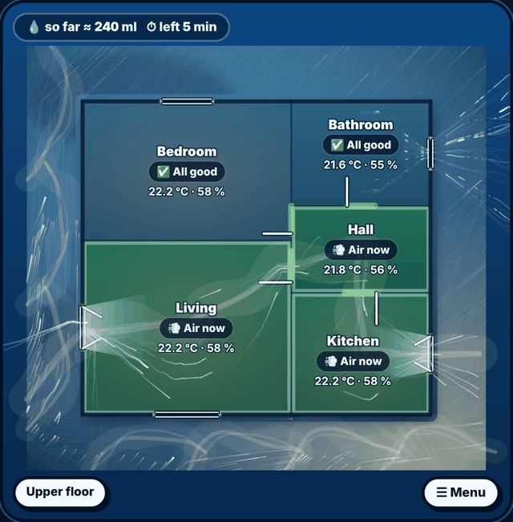
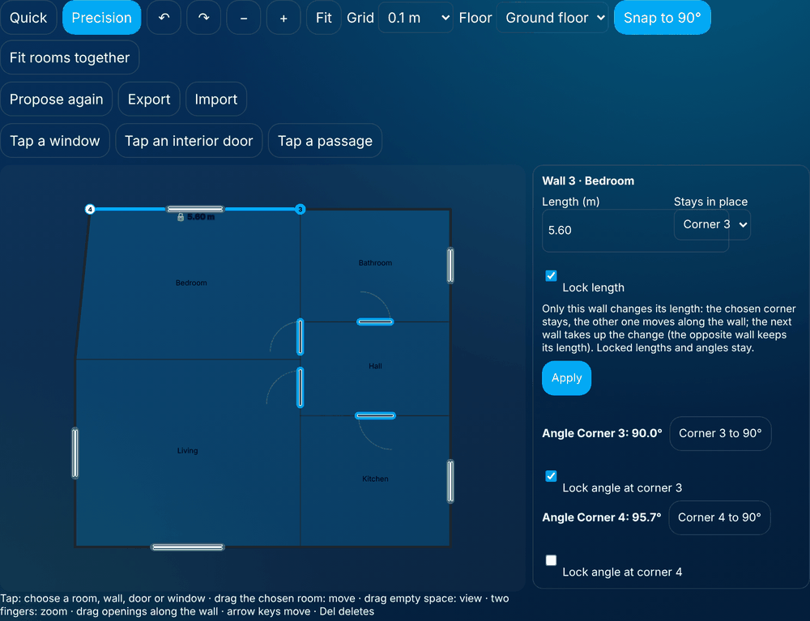
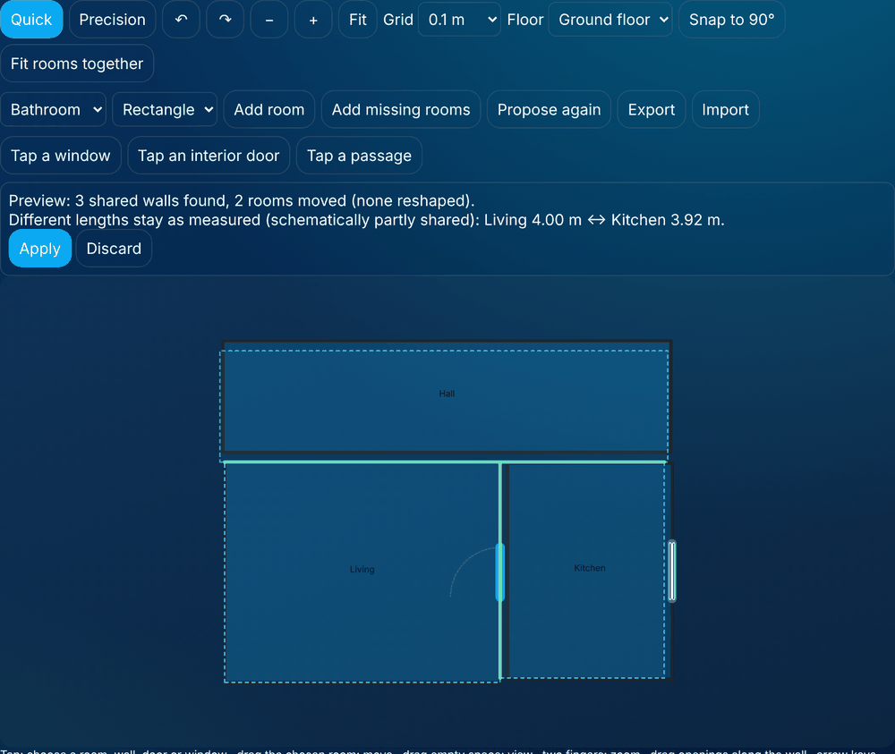

# House map (optional)

The house map shows your FreshAirIQ rooms on a freely shaped floor plan: which room needs action and why,
how far windows and doors are open, where the wind comes from and which air paths **presumably** follow.
It is an additional card – the existing dashboard, entities, recommendations, notifications and
automations stay unchanged.



## Set-up in four steps

1. **Add the card:** edit dashboard → add card → "FreshAirIQ house map" (YAML: `type: custom:freshairiq-house-card`).
   Or choose **House map (floor plan)** under "Dashboard style" of an existing FreshAirIQ card – it then shows
   the floor plan instead of the dashboard.
2. **Look at the proposal:** on first use FreshAirIQ proposes a plan from your rooms, floors, room dimensions
   or volumes, shared door contacts, open connections and window orientations. It is marked
   "Automatic proposal – not saved yet".
3. **Adjust it:** "Edit floor plan" (administrators only): move, resize and rotate rooms, set corners,
   drag windows onto the right wall.
4. **Check north and save:** with nothing selected, enter "North (degrees, direction of 'up')" and tick
   "North direction checked". Only then does the map assign the wind to individual walls.

You can skip all of this: the unsaved proposal already shows temperature, humidity, recommendations and
opening states.

## What the proposal knows – and what it does not

Home Assistant knows room names and floors, but **no** wall coordinates or window areas. Every room shows
its origin: *calculated from the setup* (length × width), *estimated* (area from volume ÷ height, 2.5 m if
unknown, assumed square), *schematic* (no size known, not to scale) or *confirmed by you*. The proposal
never changes room volumes or the room setup and is not re-arranged after a restart, weather change or
update. "Propose again" first shows how many rooms would change; "Add missing rooms" only adds new rooms.

## Editor



- **Quick:** drag a room to move it, top-right handle to resize, "Rotate 90°", rectangle/L/U templates,
  drag openings along their wall.
- **Precision:** drag corners, the dot in the middle of a wall inserts a corner, select a corner + Del/✕
  removes it, numeric coordinates, grid 0.05–0.5 m.
- Undo/redo (also Ctrl+Z/Ctrl+Y), zoom, fit, pinch zoom, arrow keys move the selected room.
- Openings: kind (window, door, roof window, passage, vent), mechanism (turn-tilt, casement, tilt only,
  sliding …), width, assigned contacts. Connections per room (open passage, door, stairs, shaft, duct).
- **View (0.26.6.0):** the floor plan fills the whole card. **☰ Menu** lies on the plan at the bottom right with the layers
  (action, temperature, humidity, CO₂, air paths, quality), details (recommendation, weather, wind and figures), floors,
  guests, notes about the drawing (proposal, estimated room sizes, north, schematic wind streams, air-path model) and
  support & diagnostics and editing. Notes that need a tap (another floor, live connection disrupted, auto focus paused)
  lie on the plan at the top left. Exterior walls thick, shared interior walls thin; windows, doors and passages with their
  own symbols; connections without a drawn opening get a marker on the wall.
- **Air stream (0.26.6.0):** air coming in through an open window moves only through connections – the drawn door or passage
  between two rooms, else the middle of the shared wall of a connection – never through a wall; without such a place the
  stream ends. At the other end it streams out of the open window again (also out of a second open window of the same
  room when no air path is known).
- **Floors (UI hotfix 0.26.6.0):** the other floors as buttons in a bar at the bottom edge of the card, below the plan (never over it); no "All floors" – for several floors add the card several times, each with `floor: ground_floor` / `floor: upper_floor` (floor id, level or name); each card keeps its own choice; a floor that needs an action (air now, close, critical) pulses gently, with reduced motion it keeps a static mark.
- **Menu and support:** the menu is a window over the plan; "Support & diagnostics" opens a window with the same functions as the FreshAirIQ card (diagnostics with required description, export, feedback).
- **Touch editing:** tap a room, wall, door or window; a finger on something not chosen moves the view, two fingers zoom, only the chosen room can be dragged. Tap a wall → enter its length in m, choose the corner that stays, apply; "Lock length" keeps it. Doors: hinge left/right and opening direction. A "door"/"open passage" connection can be drawn as a door/passage on the shared wall.
- **One wall at a time, angles and locks (editor):** a wall length changes that wall only – the chosen corner stays,
  the other one moves along the wall and the next wall takes up the change. The opposite wall keeps its length; a room
  does not have to stay a rectangle. Neighbouring rooms are never dragged along – if the wall would grow into a
  neighbour, the editor refuses and says why.
  - **Lock wall after wall:** "Lock length" keeps a length, "Lock angle at corner …" keeps an angle. Locked walls and
    angles are carried along by later edits (the locked stretch moves as a whole). If that is impossible **nothing**
    changes and the message names the wall or corner and a way out ("unlock it or keep the other corner in place").
    Free geometry stays free.
  - **90°:** the wall panel shows the angles at both corners (inner corners of L and U rooms as 270°) and a
    "Corner … to 90°" button each – only that corner is squared, never all rooms. "Snap to 90°" in the toolbar makes a
    dragged corner near 90° (±6°) snap to an exact right angle; the grid still applies.
- **Fit rooms together (editor):** measure rooms one by one, push them roughly together (to within about 35 cm) and
  tap "Fit rooms together". Facing walls are found (also 3.92 m next to 3.98 m); every room only moves as a whole –
  nothing is scaled or bent, locked dimensions win. A **preview** comes first (dashed rooms, shared walls in green, notes
  on different lengths, locked corners or overlaps); it is saved only after "Apply", undo/redo work. Afterwards the
  shared walls are interior walls (drawn once), doors on them link both rooms, windows stay on the outside wall.

  

- **Door swings in the editor only:** the editor shows a door's swing as a fine arc (to set hinge and direction).
  The house map shows the door leaf with its state and no arc; an invisible arc takes no label space.
- **Sun position:** the sun stands where `sun.sun` reports it (azimuth and elevation, turned by the plan's north) and
  moves along during the day – redrawn in 2° steps, not on every Home Assistant state change. Without a checked north
  the map only shows even daylight from above – no sun and no rays on a side that might be wrong.
- **Window with another room's contact:** a window is drawn where it is – also when its contact belongs to another
  room's setup (e.g. a guest WC window that airs the hall). The editor offers every contact for a window, those of other
  rooms marked "(airs …)". The map shows the sensor's real state; the hall's ventilation decision stays as it is. A
  contact used by two rooms only becomes a door in the proposal when it is set up as a door or is a door sensor in
  Home Assistant.
- **Floor names:** editor and map show readable names (ground floor, upper floor, basement, attic …); internal ids
  stay unchanged.
- **Room look (0.26.6.0, sixth build):** the room surface shows the state (calm/cool = all well, muted amber = wait, green/cyan/orange = act, coral with hatch = critical, a soft inner rim when an action is needed); the name on the surface, the state as a dark capsule, temperature/humidity in large rooms. The editor reports windows on an interior wall and moves them to the outside wall with one tap.
- **Labels and weather (seventh build):** labels always stay inside the real room outline (also L/U shapes); rooms too small show a state dot. Top right the outdoor weather or own sensors (`weather_sensors: sensor.a, sensor.b`).
- **Atmosphere (eighth build):** no grid – a sky that follows the weather (`sun.sun` for day/twilight/night – at night a deep night sky, rooms in dim cool light, stars by cloud cover; sun, clouds, fog, rain and snow slanted with the wind, thunder flash – only from Home Assistant data, never over the house). Rooms show their climate at rest: warm/cool glow, mist when humid (↑ while rising), dry texture, mould risk speckles along the walls, steam at a moisture source, a turning fan. While airing, fresh air reaches in at open windows (shorter when tilted) and fine particles travel with the streams; after closing it fades out. Labels keep readings before the state word and avoid door swings; small rooms show a short name ("WC"). A modelled picture, not a flow simulation.
- **Wind and air (ninth build):** a modelled wind field on a canvas layer: fine glowing threads with fading trails, broad clear air masses, deflection at the outside walls, occasional eddies behind the corners, gusts as events (measured gust when known). Through open windows the air flows into the house and on through doors to the other window; after closing it fades out. Top left: removable moisture of the whole house and the airing time (tap for the explanation). Labels keep readings and full names (two rows if needed).
- **Tenth build:** top left shows exactly the FreshAirIQ card's "removable now" and its recommended airing time (while airing: removed so far and time left). The wind's character follows the weather – light and warm in the sun, calm when cloudy, denser in rain, epic in a storm.
- **Keyboard in the editor:** tap a room, then the arrow keys (Shift = ten grid steps); undo with Ctrl/⌘+Z. A dragged room
  snaps onto a neighbour's wall line (guide line) and cannot be dropped onto another room.
- **Place openings** (bar above the drawing, also without a template): "Tap a window", "Tap an interior door",
  "Tap a passage", then tap a wall. Interior doors and passages belong on a wall between two rooms (otherwise
  "no interior wall"); the air paths read them as the link of both rooms. A door counts as open by its contact,
  a passage is always open.
  The whole width must lie on a shared wall stretch (walls up to 5 cm apart; a shared corner is not enough); the
  editor centres the opening on that stretch and shortens its width if needed. If it no longer fits later, it shows
  "counts as an outside opening".
- **Width:** drag the two round handles at the ends of a selected opening (it stays centred, inside its wall,
  at least 0.3 m, on the grid) or use "−"/"+" (5 cm each) or the "Width (m)" field.
- Problems are shown at the room ("walls cross", "overlaps another room" …); an invalid plan is not saved.
- If someone else saved in the meantime nothing is overwritten: export your draft and reload.
- Export/import as JSON.

## Floor plan template (upload a picture and tap the rooms)

Per floor you can put a picture of your plan behind the drawing (architect plan, estate agent plan, scan or photo):

1. **Upload picture** (editor → "Floor plan template"): PNG, JPEG or WebP. **PDF is not supported** – save the page
   as a picture first or take a straight photo of the plan. The picture is downscaled in the browser (longest side
   2000 pixels) and stays local in Home Assistant.
2. **Scale:** tap two points of a distance with a known length (e.g. a dimensioned wall) and enter it in metres.
   Without a scale no room is taken over.
3. **North** (optional): tap two points along the plan's north arrow – first its tail, then its tip.
4. **Tap a room:** the area enclosed by walls is detected, outlined and measured. The best matching FreshAirIQ rooms
   are suggested (compared with length × width or volume ÷ height from the room set-up); one tap assigns. A room
   that was already drawn is replaced; its windows move to the wall facing the same direction and keep their contacts.
5. **Tap a window:** tap on a wall to place a window there.

If the area is "not closed" or runs into the next room, an open door or passage connects them: raise **Close gaps**
or draw a **Separator** across the passage. Furniture, labels and dimension lines usually do not disturb; strong
shadows, oblique photos or very thin wall lines may. Detection runs entirely in the browser. There is deliberately
no fully automatic recognition of all rooms, windows and doors.

## Layers, openings, wind

Wind is drawn as soft, translucent wave ribbons that turn at walls and enter through confirmed open windows.
The waves keep flowing without a restart – also when data changes or the map is redrawn; stronger wind makes
them faster. With the device's "reduce motion" or the animation switched off they stand still.

Layers: action · temperature · humidity · CO₂ · air paths · quality. Each room's action comes from exactly the
same data as the dashboard, notifications and automation events; colour is never the only information.

| Opening shown as | Meaning |
|---|---|
| tilted / fully open | only with a proven three-state contact |
| open – kind unknown | ordinary window contact (open/closed) |
| contact open – confirmation running | this contact's configured opening delay is still running |

Wind comes from the weather entity (degrees or compass text; km/h, m/s, mph, knots). The arrow shows where
the wind comes **from**; without a direction, with stale data or calm air no arrow is drawn. Air paths are an
**estimate** – no measurement, no air speed – at the model level *connections only*, *wind estimate* (needs a
checked north or configured window orientations) or *wind + opening type*. Tap a path for its basis,
assumptions and unknowns. Single-sided airing is shown as exchange at the window; nothing is claimed through
closed doors, stairs or ceilings; a reference sensor in a neighbouring room does not prove an air path.

## Floors

The other floors are buttons in a bar below the plan; a floor that needs an action pulses gently. There is no
"All floors" overview any more – for several floors add the card several times (`floor: ground_floor`,
`floor: upper_floor` …). `auto_focus`: `off`,
`hint` (default, shows "Action on another floor"), `auto` (moves to a floor with a **new** action; a manual
choice is kept for `manual_lock_min` minutes, at most one automatic switch per minute).

```yaml
type: custom:freshairiq-house-card
auto_focus: hint          # off | hint | auto
layer: action             # action | temperature | humidity | co2 | airflow | quality
manual_lock_min: 10
animation: true
```

## What the map deliberately does not do (yet)

No flow computation (no deflection around corners, no facade vortices, no obstacles); wall exposure is a
classification and air paths are lines between openings and room centres. Tilted vs. fully open differs in symbol
and class only, not in angle, sash direction, effective area or flow rate. The proposal only produces rectangular
rooms in two simple arrangements – draw real L/U shapes, the outline and split levels in the editor. Floor auto
focus defaults to hint only (`auto_focus: auto` switches automatically). No PDF template (pictures only), no fully automatic room recognition.

## Privacy and limits

The plan is stored locally in Home Assistant (`.storage/freshairiq.house_layout.<entry>`), is **not** sent to
the diagnostics hub and is not part of the diagnostics export. A plan template (picture) is kept separately in `.storage/freshairiq.house_underlay.<entry>`, also local only and not part of diagnostics; it is shown in the editor only. Deleting the integration deletes both files. No cloud, no map services; without internet or
wind data the map stays fully usable. Saving is for administrators only; Home Assistant areas, floors and
devices are only read. No CFD, no measured air volumes, obstacles are not considered. Example plan without real
data: [examples/house_map_demo.json](examples/house_map_demo.json).
