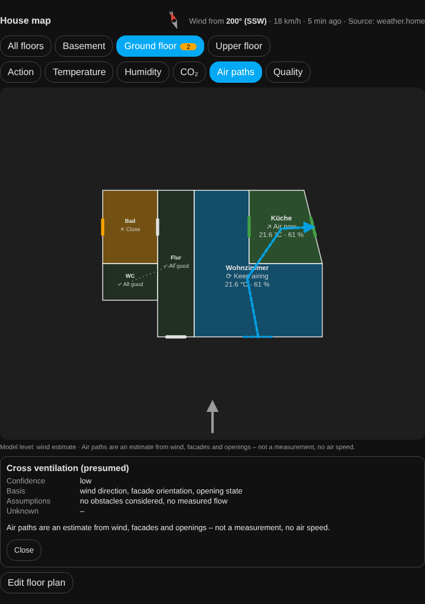

# House map (optional)

The house map shows your FreshAirIQ rooms on a freely shaped floor plan: which room needs action and why,
how far windows and doors are open, where the wind comes from and which air paths **presumably** follow.
It is an additional card – the existing dashboard, entities, recommendations, notifications and
automations stay unchanged.



## Set-up in four steps

1. **Add the card:** edit dashboard → add card → "FreshAirIQ house map" (YAML: `type: custom:freshairiq-house-card`).
   Or choose **House map (floor plan)** under "Dashboard style" of an existing FreshAirIQ card – it then shows
   the floor plan instead of the dashboard.
2. **Look at the proposal:** on first use FreshAirIQ proposes a plan from your rooms, floors, room dimensions
   or volumes, shared door contacts, open connections and window orientations. It is marked
   "Automatic proposal – not saved yet".
3. **Adjust it:** "Edit floor plan" (administrators only): move, resize and rotate rooms, set corners,
   drag windows onto the right wall.
4. **Check north and save:** with nothing selected, enter "North (degrees, direction of 'up')" and tick
   "North direction checked". Only then does the map assign the wind to individual walls.

You can skip all of this: the unsaved proposal already shows temperature, humidity, recommendations and
opening states.

## What the proposal knows – and what it does not

Home Assistant knows room names and floors, but **no** wall coordinates or window areas. Every room shows
its origin: *calculated from the setup* (length × width), *estimated* (area from volume ÷ height, 2.5 m if
unknown, assumed square), *schematic* (no size known, not to scale) or *confirmed by you*. The proposal
never changes room volumes or the room setup and is not re-arranged after a restart, weather change or
update. "Propose again" first shows how many rooms would change; "Add missing rooms" only adds new rooms.

## Editor

- **Quick:** drag a room to move it, top-right handle to resize, "Rotate 90°", rectangle/L/U templates,
  drag openings along their wall.
- **Precision:** drag corners, the dot in the middle of a wall inserts a corner, select a corner + Del/✕
  removes it, numeric coordinates, grid 0.05–0.5 m.
- Undo/redo (also Ctrl+Z/Ctrl+Y), zoom, fit, pinch zoom, arrow keys move the selected room.
- Openings: kind (window, door, roof window, passage, vent), mechanism (turn-tilt, casement, tilt only,
  sliding …), width, assigned contacts. Connections per room (open passage, door, stairs, shaft, duct).
- **Place openings** (bar above the drawing, also without a template): "Tap a window", "Tap an interior door",
  "Tap a passage", then tap a wall. Interior doors and passages belong on a wall between two rooms (otherwise
  "no interior wall"); the air paths read them as the link of both rooms. A door counts as open by its contact,
  a passage is always open.
  The whole width must lie on a shared wall stretch (walls up to 5 cm apart; a shared corner is not enough); the
  editor centres the opening on that stretch and shortens its width if needed. If it no longer fits later, it shows
  "counts as an outside opening".
- **Width:** drag the two round handles at the ends of a selected opening (it stays centred, inside its wall,
  at least 0.3 m, on the grid) or use "−"/"+" (5 cm each) or the "Width (m)" field.
- Problems are shown at the room ("walls cross", "overlaps another room" …); an invalid plan is not saved.
- If someone else saved in the meantime nothing is overwritten: export your draft and reload.
- Export/import as JSON.

## Floor plan template (upload a picture and tap the rooms)

Per floor you can put a picture of your plan behind the drawing (architect plan, estate agent plan, scan or photo):

1. **Upload picture** (editor → "Floor plan template"): PNG, JPEG or WebP. **PDF is not supported** – save the page
   as a picture first or take a straight photo of the plan. The picture is downscaled in the browser (longest side
   2000 pixels) and stays local in Home Assistant.
2. **Scale:** tap two points of a distance with a known length (e.g. a dimensioned wall) and enter it in metres.
   Without a scale no room is taken over.
3. **North** (optional): tap two points along the plan's north arrow – first its tail, then its tip.
4. **Tap a room:** the area enclosed by walls is detected, outlined and measured. The best matching FreshAirIQ rooms
   are suggested (compared with length × width or volume ÷ height from the room set-up); one tap assigns. A room
   that was already drawn is replaced; its windows move to the wall facing the same direction and keep their contacts.
5. **Tap a window:** tap on a wall to place a window there.

If the area is "not closed" or runs into the next room, an open door or passage connects them: raise **Close gaps**
or draw a **Separator** across the passage. Furniture, labels and dimension lines usually do not disturb; strong
shadows, oblique photos or very thin wall lines may. Detection runs entirely in the browser. There is deliberately
no fully automatic recognition of all rooms, windows and doors.

## Layers, openings, wind

Wind is drawn as soft, translucent wave ribbons that turn at walls and enter through confirmed open windows.
The waves keep flowing without a restart – also when data changes or the map is redrawn; stronger wind makes
them faster. With the device's "reduce motion" or the animation switched off they stand still.

Layers: action · temperature · humidity · CO₂ · air paths · quality. Each room's action comes from exactly the
same data as the dashboard, notifications and automation events; colour is never the only information.

| Opening shown as | Meaning |
|---|---|
| tilted / fully open | only with a proven three-state contact |
| open – kind unknown | ordinary window contact (open/closed) |
| contact open – confirmation running | this contact's configured opening delay is still running |

Wind comes from the weather entity (degrees or compass text; km/h, m/s, mph, knots). The arrow shows where
the wind comes **from**; without a direction, with stale data or calm air no arrow is drawn. Air paths are an
**estimate** – no measurement, no air speed – at the model level *connections only*, *wind estimate* (needs a
checked north or configured window orientations) or *wind + opening type*. Tap a path for its basis,
assumptions and unknowns. Single-sided airing is shown as exchange at the window; nothing is claimed through
closed doors, stairs or ceilings; a reference sensor in a neighbouring room does not prove an air path.

## Floors

Floor tabs with the number of rooms needing action, plus an "All floors" overview. `auto_focus`: `off`,
`hint` (default, shows "Action on another floor"), `auto` (moves to a floor with a **new** action; a manual
choice is kept for `manual_lock_min` minutes, at most one automatic switch per minute).

```yaml
type: custom:freshairiq-house-card
auto_focus: hint          # off | hint | auto
layer: action             # action | temperature | humidity | co2 | airflow | quality
manual_lock_min: 10
animation: true
```

## What the map deliberately does not do (yet)

No flow computation (no deflection around corners, no facade vortices, no obstacles); wall exposure is a
classification and air paths are lines between openings and room centres. Tilted vs. fully open differs in symbol
and class only, not in angle, sash direction, effective area or flow rate. The proposal only produces rectangular
rooms in two simple arrangements – draw real L/U shapes, the outline and split levels in the editor. Floor auto
focus defaults to hint only (`auto_focus: auto` switches automatically). No PDF template (pictures only), no fully automatic room recognition.

## Privacy and limits

The plan is stored locally in Home Assistant (`.storage/freshairiq.house_layout.<entry>`), is **not** sent to
the diagnostics hub and is not part of the diagnostics export. A plan template (picture) is kept separately in `.storage/freshairiq.house_underlay.<entry>`, also local only and not part of diagnostics; it is shown in the editor only. Deleting the integration deletes both files. No cloud, no map services; without internet or
wind data the map stays fully usable. Saving is for administrators only; Home Assistant areas, floors and
devices are only read. No CFD, no measured air volumes, obstacles are not considered. Example plan without real
data: [examples/house_map_demo.json](examples/house_map_demo.json).
